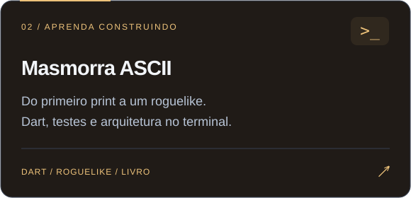

<a href="https://kleberandrade.dev/">
  <picture>
  <source media="(max-width: 600px)" srcset="assets/hero-mobile.svg" />
  
  </picture>
</a>

  <a href="https://kleberandrade.dev/"><strong>Portfólio ↗</strong></a> &nbsp; · &nbsp;
  <a href="https://koativa.com.br/">Koativa</a> &nbsp; · &nbsp;
  <a href="https://www.linkedin.com/in/kleberandrade/">LinkedIn</a> &nbsp; · &nbsp;
  <a href="https://x.com/pdjkleber">X / Twitter</a>

Sou **Kleber Andrade**, CEO da **Koativa** e CTO da **NVPro**. Trabalho entre estratégia, arquitetura e desenvolvimento, da definição do problema à entrega do produto.

Minha trajetória conecta **tecnologia financeira, inteligência artificial e robótica**. Sou doutor em Engenharia Mecânica pela **USP**, ensinei programação por mais de uma década e escrevo histórias para tornar a engenharia de software mais fácil de entender.

### 01 / Projetos para explorar

**Experimente:** [23 padrões na prática ↗](https://o-grimorio-dos-padroes.vercel.app/) · [Dart na masmorra ↗](https://masmorra.io/) · [Todos os projetos ↗](https://kleberandrade.dev/#projects)

### 02 / Uma biblioteca de magia e código

Nos meus livros, refatorações viram missões, decisões de arquitetura têm consequências e trabalhar em equipe faz parte da aventura.

  &nbsp;
  &nbsp;
  &nbsp;
  &nbsp;
  

**Para quem constrói software** · [Código limpo](https://clubedeautores.com.br/livro/a-ordem-do-codigo-limpo-2) e [padrões de projeto](https://clubedeautores.com.br/livro/o-grimorio-dos-padroes). 
**Para quem conduz produtos e times** · [Agilidade](https://clubedeautores.com.br/livro/o-mestre-dos-magos-da-agilidade), [produto](https://clubedeautores.com.br/livro/a-ordem-dos-product-owners-perdidos) e [IA no trabalho](https://clubedeautores.com.br/livro/o-ultimo-sprint-da-humanidade).

[**Conheça a biblioteca completa →**](https://kleberandrade.dev/#books)

### 03 / Ferramentas e campos de atuação

**Sistemas & APIs** &nbsp; TypeScript · NestJS · C# · Python · Java 
**Aplicações & jogos** &nbsp; Flutter · Dart · Unity · C++ 
**Pesquisa aplicada** &nbsp; Inteligência artificial · Robótica · Tecnologias para saúde

---

  <strong>Uma ideia, um desafio de arquitetura ou uma boa conversa.</strong> 
  Vamos conectar?  
  <a href="https://www.linkedin.com/in/kleberandrade/"><strong>LinkedIn ↗</strong></a> &nbsp; · &nbsp;
  <a href="https://koativa.com.br/">Projetos com a Koativa ↗</a> &nbsp; · &nbsp;
  <a href="https://kleberandrade.dev/">Meu universo ↗</a>

