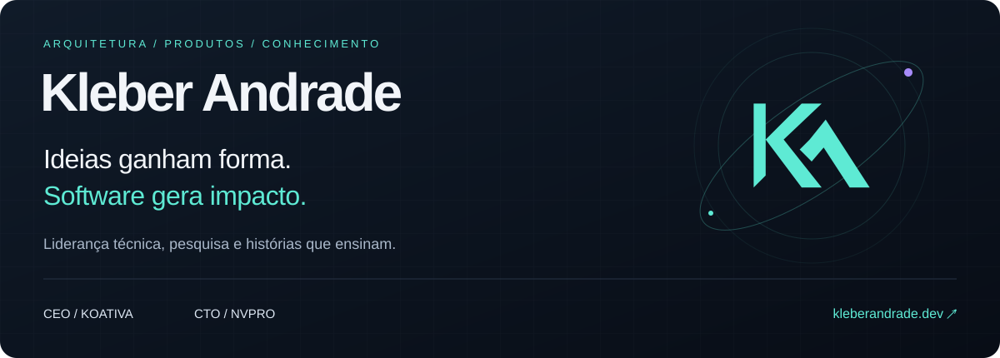
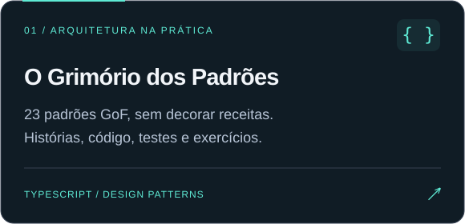
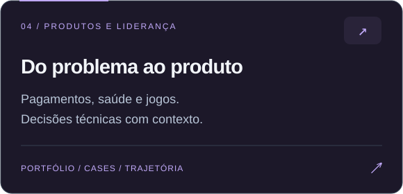

<a href="https://kleberandrade.dev/">
  <picture>
  <source media="(max-width: 600px)" srcset="assets/hero-mobile.svg" />
  
  </picture>
</a>

  <a href="https://kleberandrade.dev/"><strong>Portfólio ↗</strong></a> &nbsp; · &nbsp;
  <a href="https://koativa.com.br/">Koativa</a> &nbsp; · &nbsp;
  <a href="https://www.linkedin.com/in/kleberandrade/">LinkedIn</a> &nbsp; · &nbsp;
  <a href="https://x.com/pdjkleber">X / Twitter</a>

### Estratégia para decidir. Engenharia para construir.

Sou **gestor, pesquisador, desenvolvedor, escritor e palestrante**. Na **Koativa**, conecto estratégia, arquitetura e desenvolvimento para transformar problemas reais em produtos digitais. Também atuo como **CTO da NVPro**.

**Doutor em Engenharia Mecânica pela USP**, com trajetória em tecnologia financeira, IA e robótica e mais de uma década ensinando programação e engenharia de software. Compartilho o que aprendo em código, livros e palestras.

 

### Em construção, em código, no mundo.

[**Estude os padrões na prática →**](https://o-grimorio-dos-padroes.vercel.app/) &nbsp; · &nbsp; [Conheça a Lufta e outros projetos →](https://kleberandrade.dev/#projects)

 

### Tecnologia também se conta em histórias.

Fantasia, arquitetura e decisões que todo time de software reconhece. Um pouco do meu universo de livros:

  &nbsp;
  &nbsp;
  &nbsp;
  &nbsp;
  

<a href="https://kleberandrade.dev/#books"><strong>Explore os livros e seus universos →</strong></a>

 

### Meu repertório, em poucas linhas.

**Backend & arquitetura** &nbsp; TypeScript · NestJS · C# · Python · Java 
**Aplicações & jogos** &nbsp; Flutter · Dart · Unity · C++ 
**Pesquisa & prática** &nbsp; IA · Robótica · Jogos sérios · Tecnologias para saúde

---

  <strong>Vamos transformar uma ideia em algo que funciona?</strong>  
  <a href="https://www.linkedin.com/in/kleberandrade/">Converse comigo no LinkedIn ↗</a> &nbsp; · &nbsp;
  <a href="https://koativa.com.br/">Conheça a Koativa ↗</a>

